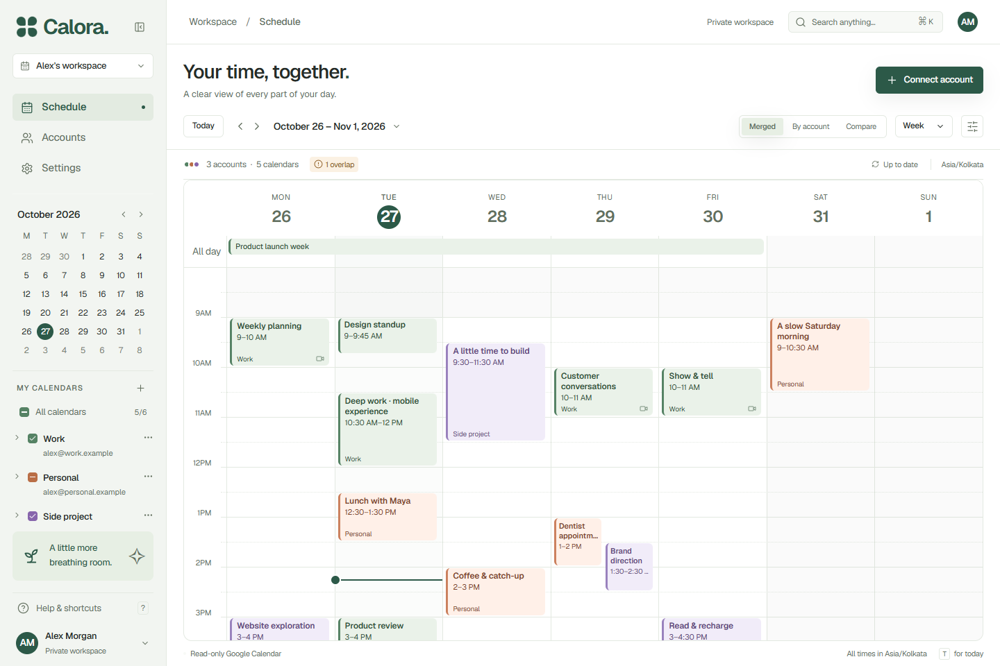
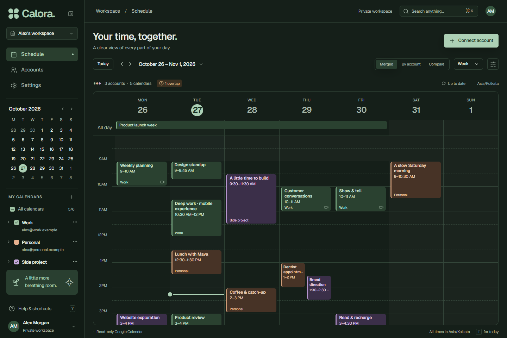
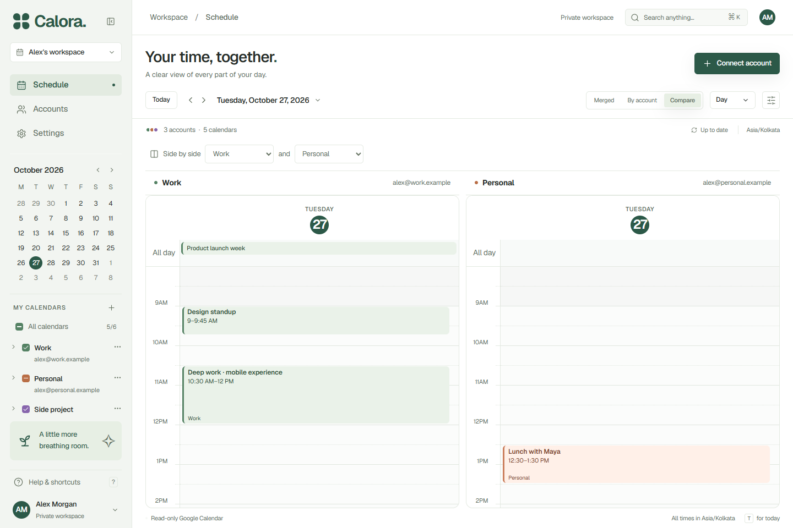
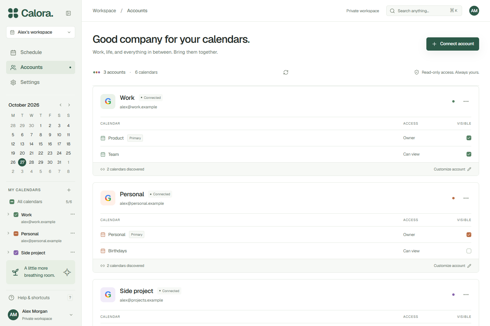
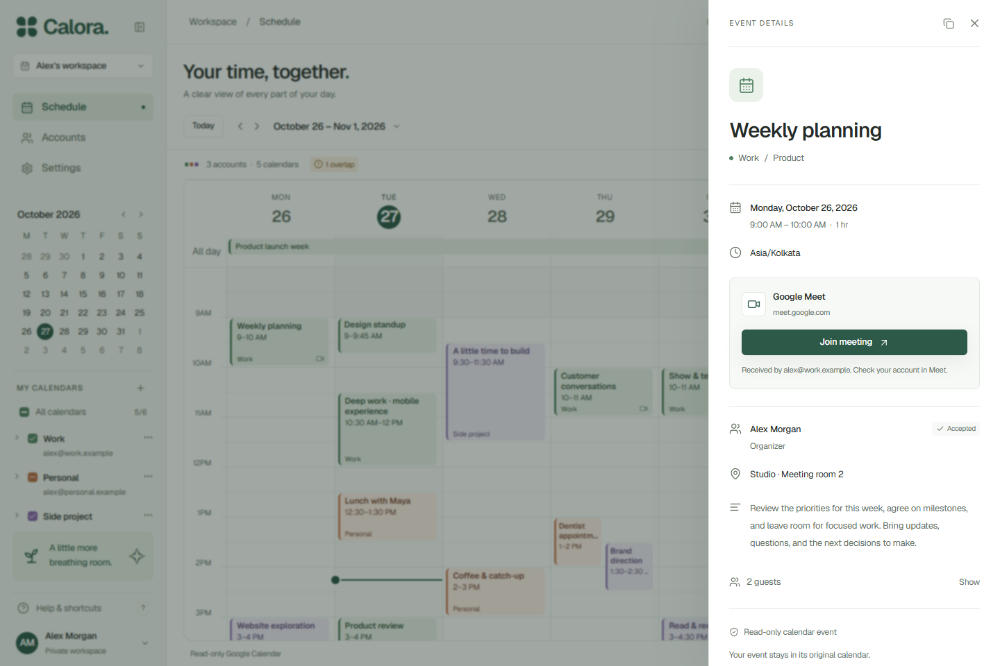
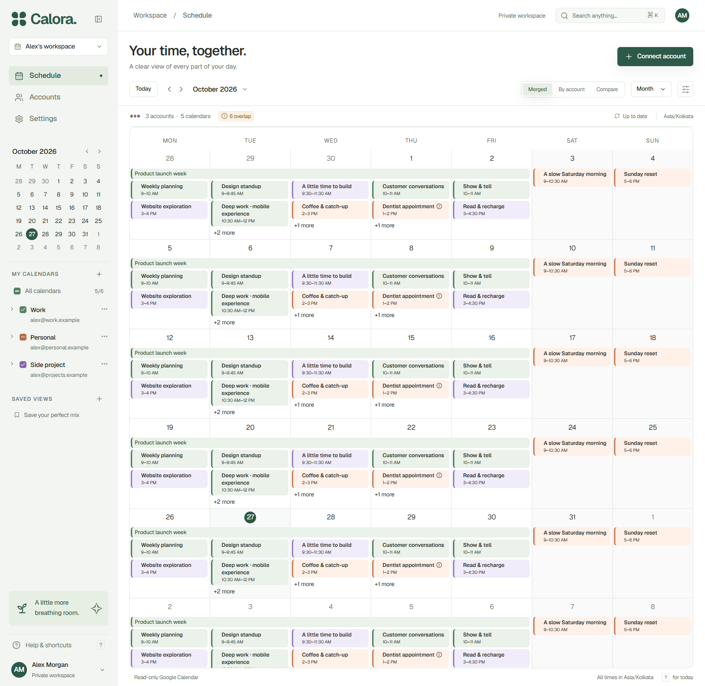
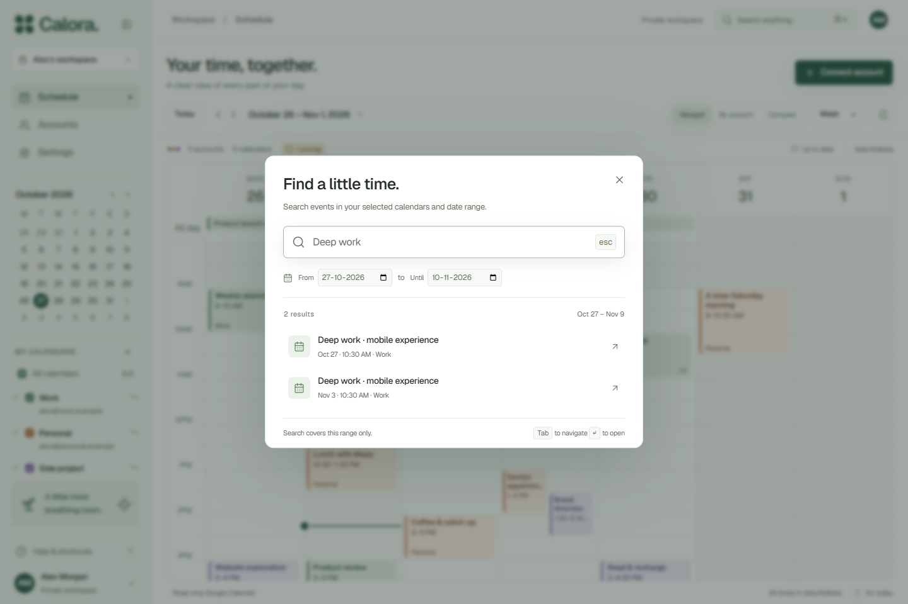
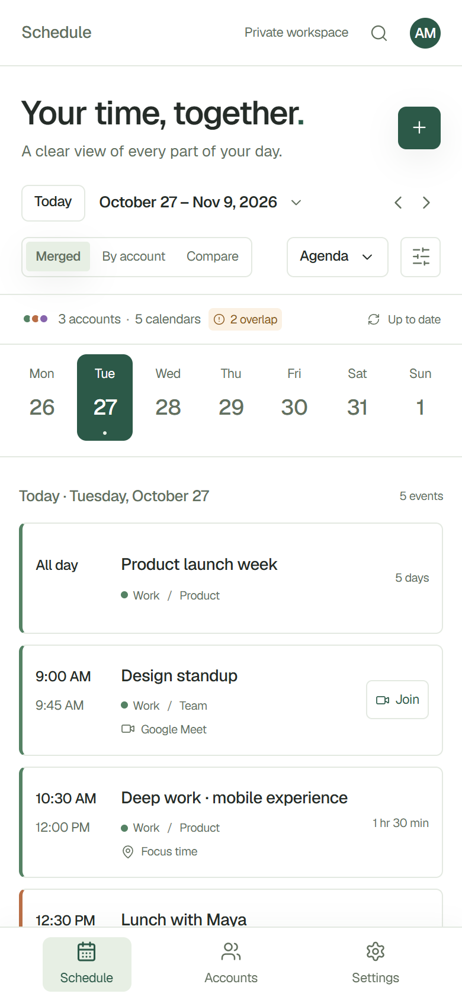
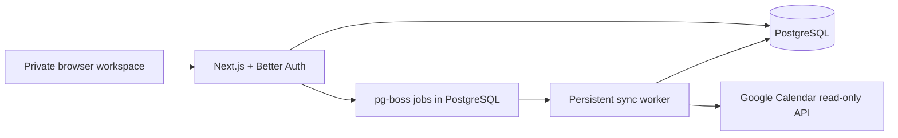

# Calora

**Your time, together.** A private workspace for seeing work, life, and side projects across multiple Google Calendar accounts.

Merge your calendars into one schedule, compare two accounts side by side, and find the meeting you need without switching Google identities. Calora reads your calendars while leaving event creation and editing in Google Calendar.

[Live app](https://calora-lilac.vercel.app) · [Developer portfolio](https://autobots.origin-studio.in/developer/index.html#projects) · [Deployment guide](docs/vercel-deployment.md) · [Calendar behavior](docs/calendar-behavior.md)

The live workspace requires the configured owner's Google sign-in. The screenshots below provide a public product tour.



## What you can do

| Feature | How it helps |
| --- | --- |
| **Multiple Google accounts** | Connect personal and Workspace identities to the same private workspace; choose calendars individually. |
| **Three ways to see your schedule** | Merge everything, browse by account, or compare two accounts side by side. |
| **Day to month** | Switch between Day, Three days, Week, Month, and Agenda; use a compact agenda on your phone. |
| **A clearer calendar** | Account colors, working-hour shading, all-day events, and overlap indicators keep a busy week readable. |
| **Calendar mixes** | Save a selection of calendars and return to it later. |
| **Invitation grouping** | Group matching copies of shared invitations while keeping materially different copies distinguishable. |
| **Search and event details** | Search selected calendars within a date window of up to 62 days; inspect attendees, locations, responses, and meeting links. |
| **Light, dark, or system** | Consistent themes across the calendar, menus, forms, account pages, and event sheets. |
| **Visible sync health** | See freshness, missing coverage, restricted calendars, and accounts that need attention; retry discovery after fixing access. |

## A closer look

| Dark appearance | Two-account comparison |
| --- | --- |
|  |  |
| A shared set of theme colors keeps event text and grid lines readable. | Compare the same date across two Google identities. |

| Account management | Event details |
| --- | --- |
|  |  |
| Discover calendars, adjust visibility, and customize each connection. | Open the context behind an event and join its meeting. |

| Month overview | Calendar search |
| --- | --- |
|  |  |
| Scan a broader date range without losing account colors. | Find events within an explicit range and open a result. |

### On your phone

The agenda brings the day's events, meeting links, and account context into a single column, with bottom navigation for Schedule, Accounts, and Settings.



**Screenshot data:** these are captures of the implemented UI using isolated browser test fixtures and fictional identities. No private accounts or meetings are pictured. Production starts empty and does not seed sample content.

## Built with

| Layer | Tools |
| --- | --- |
| Application | Next.js 16, React 19, TypeScript |
| Interface | FullCalendar 7, Tailwind CSS 4, Radix UI, Lucide |
| State and dates | TanStack Query, Temporal polyfill |
| Identity | Better Auth, server-side Google OAuth |
| Persistence | PostgreSQL, Prisma 7 |
| Background sync | A persistent Node.js worker with pg-boss |
| Hosting | Vercel web application and worker, Supabase PostgreSQL |
| Verification | Vitest and Playwright |



The worker fetches every page in a requested range before publishing a replacement snapshot. Failed or incomplete syncs produce coverage notices instead of silently presenting missing events as free time. See [calendar behavior](docs/calendar-behavior.md) for grouping, overlap, time-zone, and snapshot rules.

## Run locally

Use **Node.js 24** and a hosted PostgreSQL database, such as Supabase. Local Docker is not required.

```sh
npm ci
```

Copy [.env.production.example](.env.production.example) to **`.env.local`**, then fill in the values below. For local development, set `BETTER_AUTH_URL=http://localhost:3000`.

| Variable | Value |
| --- | --- |
| `DATABASE_URL` | Supabase **Transaction pooler** URL, port `6543`, with `sslmode=require`. |
| `DIRECT_DATABASE_URL` | **Session pooler** URL, port `5432`, for migrations and jobs, pointing to the same database. A reachable direct connection also works. |
| `BETTER_AUTH_URL` | Application origin, without a trailing slash. Use stable HTTPS in production. |
| `BETTER_AUTH_SECRET` | Random secret of at least 32 characters. |
| `OWNER_EMAIL` | Verified Google email allowed to sign in to the dashboard. |
| `GOOGLE_CLIENT_ID` | Google OAuth client ID for a **Web application**. |
| `GOOGLE_CLIENT_SECRET` | That client's secret. |
| `TOKEN_ENCRYPTION_KEY` | A separate random 32-byte key, encoded as base64. |
| `TOKEN_KEY_VERSION` | `1`. |
| `OWNER_GOOGLE_SUB` | Optional: pin the owner's Google subject after the first sign-in. |

Generate **two independent secrets** by running this command twice; use one for authentication and the other for token encryption:

```sh
node -e "console.log(require('node:crypto').randomBytes(32).toString('base64'))"
```

Copy the database URLs from Supabase's **Connect** dialog, percent-encode special characters in the password, and disable its Data API for this dedicated Prisma-only database. Calora uses Better Auth and server-side SQL; Supabase publishable and service-role API keys are unnecessary. Keep all environment values server-side, without a `NEXT_PUBLIC_` prefix.

In Google Cloud, **enable Google Calendar API**, configure the OAuth audience and test users, and register both local callbacks on your Web application client:

```text
http://localhost:3000/api/auth/callback/google
http://localhost:3000/api/integrations/google/callback
```

The first callback signs in the owner; the second connects calendar accounts. Register the corresponding HTTPS callbacks for production.

Apply migrations, then start the web application:

```sh
npm run db:migrate
npm run dev
```

Start the sync worker in a **second terminal**:

```sh
npm run worker
```

Open [localhost:3000](http://localhost:3000), sign in as the owner, and connect your Google accounts. An unconfigured development checkout displays an empty setup workspace.

## Deploy

Follow the [Vercel and Supabase deployment guide](docs/vercel-deployment.md) for the environment setup, database connections, Google consent configuration, migrations, and troubleshooting.

Calora needs **PostgreSQL, the Next.js application, and a persistent worker**. The repository includes `vercel.json`, a production build script, and a worker container definition for Vercel Daemons. No local Docker setup is needed. A web-only deployment will not sync calendars; a static export cannot run the application.

## Privacy and access

- Only the configured owner can enter the dashboard. Connecting another Google identity does not give it dashboard access.
- Calendar connections request calendar-list and event **read-only scopes**. Calora cannot create, move, delete, or RSVP to Google events.
- Calendar credentials are encrypted server-side with AES-256-GCM. Keep the encryption key stable and backed up separately; changing it without a migration requires reconnection.
- Private API responses use `private, no-store`. Event content is not persisted in localStorage or a service-worker cache.
- Missing permissions and incomplete coverage stay visible. Availability-only calendars are marked as restricted; free/busy access is outside this release.

## Development checks

```sh
npm run typecheck
npm test
npm run test:e2e
npm run build
```

Browser checks use installed Chrome and isolated network fixtures; the application never imports those fixtures. PostgreSQL integration checks are available through `npm run test:db` and require a **separate, migrated disposable database** via `DATABASE_URL`.

[Acceptance notes](docs/acceptance.md) record verification coverage and limitations. Event editing, other calendar providers, Google watch notifications, and incremental sync are future scope.

Built by [Adarsh Viswam](https://github.com/adarshnub) · [More projects](https://autobots.origin-studio.in/developer/index.html#projects)
